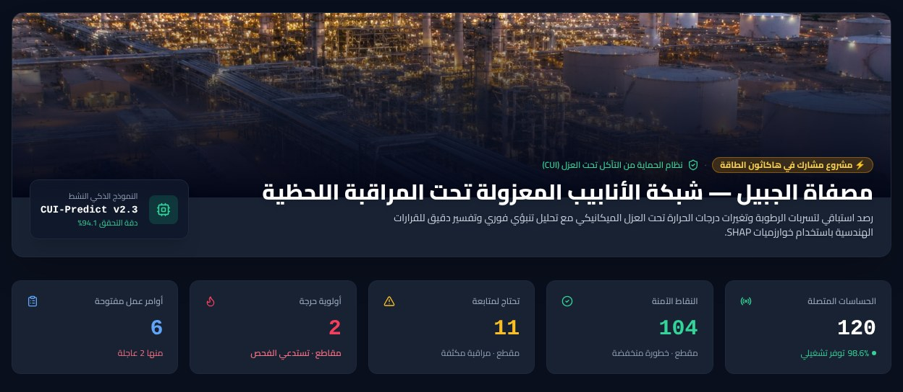
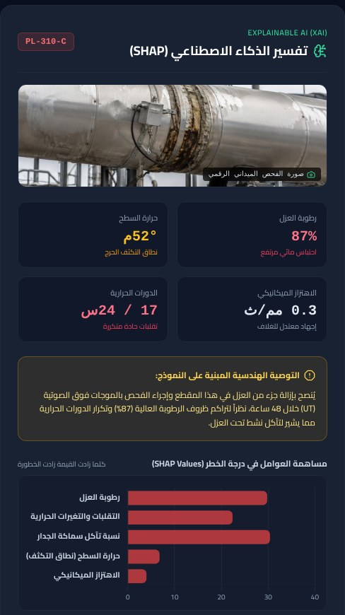

<!-- ===================== HEADER ===================== -->

  

  

  
  
  

<!-- ===================== QUICK STATS ===================== -->
<table align="center">
  <tr>
    <td align="center" width="170"><h2>🏆 3+</h2>Hackathon Awards</td>
    <td align="center" width="170"><h2>🚀 6</h2>Innovation Projects</td>
    <td align="center" width="170"><h2>📜 8</h2>Professional Certificates</td>
    <td align="center" width="170"><h2>🎯 Top 15</h2>out of 300+ teams</td>
  </tr>
</table>

---

## 👩‍💻 About Me

AI Solutions Builder and Information Systems student focused on **technology-driven solutions**, **data analysis** and **UI/UX design**. With a strong background in leadership and project management, I bring hands-on skills in web development and a fast-learning approach to deliver measurable impact. Motivated to build practical solutions that solve real-world problems and create meaningful value for organizations.

- 🎓 **Bachelor’s in Information Systems**, Najran University
- 🌐 **Languages:** Arabic, English

 

---

## 🚀 Featured Projects

   

<h2><a href="https://github.com/RSA445/Sawn-CUI-Platform">⚡ Sawn (صَوْن) ↗</a></h2>
<b>National CUI Monitoring & Predictive Maintenance Platform</b>  

  

<table>
  <tr>
    <td width="62%" valign="top">
      <b>The challenge:</b> Corrosion Under Insulation (CUI) is one of the costliest hidden threats in oil, gas and energy facilities. It wastes heat, causes leaks, and is usually found only by stripping the insulation by hand.  
      <b>What Sawn does:</b> 
      • Monitors insulated pipelines in real time through IoT sensor telemetry over LoRaWAN (simulated in this prototype). 
      • Scores CUI risk for each pipe section from insulation moisture, temperature, thermal cycles, vibration and wall-thickness loss. 
      • Explains every alert with SHAP-style factor contributions, so integrity engineers see exactly why a section is flagged. 
      • Turns high-risk sections into inspection work orders (UT and digital radiography) and offers a live simulation mode. 
      • Full Arabic RTL industrial dashboard with a live risk map and charts.  
             
      
    </td>
    <td width="38%" align="center" valign="top">
       
      Explainable AI panel: why a pipe section is at risk
    </td>
  </tr>
</table>

 

<table>
  <tr>
    <td width="50%" valign="top">
      <h3><a href="https://github.com/RSA445/Wjhny">🕋 Wjhny ↗</a></h3>
      <b>AI-Powered Pilgrimage Assistant</b>  
      • Developed an AI and AR-based solution for crowd management during Hajj and Umrah. 
      • Selected among the top 15 teams out of 300+ participants. 
      • Advanced to the incubation stage and presented at the Hajj & Umrah Conference 2025.  
          
      
    </td>
    <td width="50%" valign="top">
      <h3><a href="https://github.com/RSA445/Nabeh">🎓 Nabeh ↗</a></h3>
      <b>AI-Powered Academic Advising Chatbot</b>  
      • Built an AI academic advising chatbot using insights from faculty, top students and university regulations. 
      • Gives instant answers tailored to major and level, with remedial plans and instructor guidance. 
      • Links to the university account for privacy and personalized, always-available support.  
          
      
    </td>
  </tr>
  <tr>
    <td width="50%" valign="top">
      <h3><a href="https://github.com/RSA445/Bunyan">🥽 Bunyan ↗</a></h3>
      <b>VR-Based Therapy Solution</b>  
      • Developed a VR-based tool to support children during physiotherapy sessions. 
      • Improved engagement and therapy effectiveness.  
         
      
    </td>
    <td width="50%" valign="top">
      <h3><a href="https://github.com/RSA445/Wisal">🏛️ Wisal ↗</a></h3>
      <b>Digital Public Service Improvement Platform</b>  
      • Designed solutions to improve the accessibility and efficiency of public services in Najran.  
          
      
    </td>
  </tr>
  <tr>
    <td colspan="2" valign="top">
      <h3><a href="https://github.com/RSA445/UniReco">📨 UniReco ↗</a></h3>
      <b>Academic Recommendation Letter Management System</b>  
      • Built a full web system that automates academic recommendation letters, from the student's request to a verified PDF. 
      • Separate portals for students, professors, receiving universities and admins, with digital signatures and PDF generation. 
      • Secure tokenized links let universities verify letters, plus OTP password reset and email notifications.  
             
      
    </td>
  </tr>
</table>

### 💻 Code on GitHub

| Repository | Description | Stack |
| --- | --- | --- |
| [**Sawn**](https://github.com/RSA445/Sawn-CUI-Platform) | CUI monitoring & predictive maintenance platform (Energy Hackathon) |    |
| [**UniReco**](https://github.com/RSA445/UniReco) | Academic recommendation letter management system |    |
| [**ResearchHub**](https://github.com/RSA445/ResearchHub) | Desktop prototype of an Arabic research-sharing platform |   |
| [**Rozalya Diamond**](https://github.com/RSA445/Rozalya_Diamond) | Website for a gold & diamond jewelry store |   |

---

## 💼 Experience

<table>
  <tr>
    <td width="70" align="center"><h1>🧑‍💻</h1></td>
    <td>
      <b>Leader</b> · Programming Club 
       
      ▸ Led club strategy, operations, and technical initiatives. 
      ▸ Managed teams and organized workshops and competitions. 
      ▸ Drove student engagement in programming activities.
    </td>
  </tr>
  <tr>
    <td width="70" align="center"><h1>🌍</h1></td>
    <td>
      <b>Ambassador</b> · Oracle Corporation, Hult Prize Foundation & Venture Craft KFUPM 
       
      ▸ Represent multiple programs in technology and entrepreneurship. 
      ▸ Promote certifications and innovation initiatives. 
      ▸ Guide students in skill development and participation.
    </td>
  </tr>
  <tr>
    <td width="70" align="center"><h1>📚</h1></td>
    <td>
      <b>Vice Head</b> · Training & Development Committee, Programming Club 
       
      ▸ Planned and delivered technical workshops. 
      ▸ Trained students on programming fundamentals. 
      ▸ Improved onboarding and learning experience.
    </td>
  </tr>
</table>

---

## 🏆 Awards and Achievements

| | Award | Project |
| :---: | --- | --- |
| 🏅 | **Recognized by the Regional Governor** | Wisal – Digital Public Service Improvement Platform |
| 🥉 | **3rd Place** | Wisal – Digital Public Service Improvement Platform |
| 🥉 | **3rd Place** | Bunyan – National-Level Competition |
| 🎯 | **Top 15 out of 300+ teams** | Wjhny – AI-Powered Pilgrimage Assistant |

---

## 📜 Professional Certificates

  

🔎 Verify: <a href="https://coursera.org/verify/J80QD92ZZQIZ">University of Michigan</a> · <a href="https://courses.minnalearn.com/certificate/en/elements-of-ai-for-business/d9d64aed-3248-4259-aace-fb9b03eb20b3">MinnaLearn</a> · <a href="https://learn.founderz.com/certificate/ai-skills-4-women-tech-saudi-advocates/038a27e6-5dbc-48ed-8d4d-6010bd940cd3">AI Skills 4 Women</a>

---

## 🛠️ Skills & Tools

  

<table align="center">
  <tr>
    <th>⚙️ Skills</th>
    <th>🧰 Tools</th>
    <th>🤝 Soft Skills</th>
  </tr>
  <tr>
    <td>✓ Python ✓ JavaScript ✓ HTML & CSS ✓ Pandas & NumPy ✓ Data Analysis & Reporting ✓ UI/UX Design & Prototyping</td>
    <td>✓ Git ✓ Docker ✓ MLflow (MLOps) ✓ OpenAI & DeepSeek ✓ Figma ✓ Microsoft Excel & PowerPoint</td>
    <td>✓ Team Leadership ✓ Project & Event Management ✓ Public Speaking ✓ Analytical Thinking ✓ Problem Solving ✓ Arabic & English</td>
  </tr>
</table>

---

  <b>📫 Let’s build something meaningful together.</b>  
  
  

  

